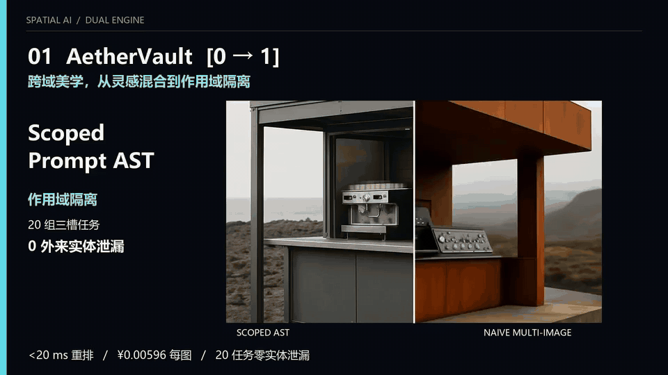
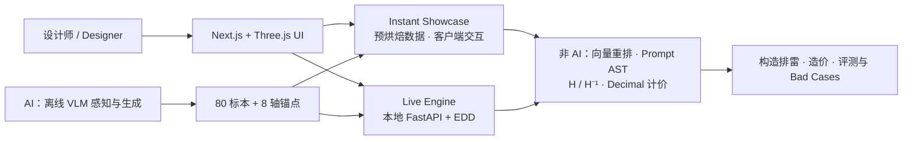

# Spatial AI 双引擎作品集 / Dual-Engine Portfolio

[](https://frostales-code.github.io/spatial-ai-portfolio/)    



[立即体验 / Live Showcase](https://frostales-code.github.io/spatial-ai-portfolio/) · [90 秒演示 / Showreel](docs/media/showreel_90s.mp4) · [评测报告 / Evaluation](eval/reports/EDD_BENCHMARK_REPORT.md) · [三分钟演示剧本](docs/THREE_MINUTE_DEMO_SCRIPT.md)

灵感跨图混合时容易串色；商业立面效果图也可能忽略施工与造价。这里用两个引擎连接创意与建造：**AetherVault [0→1]** 将跨领域美学拆成可组合的作用域；**TectonicLoop [1→N]** 将立面方案连接到构造规则、透视拼缝与确定性计价。

## 架构 / Architecture



线上版使用预烘焙数据；本地模式运行 Python 管线与评测。前端为 Next.js 15 静态导出、shadcn/ui、Three.js 和 Recharts；后端为 FastAPI。

## 评测与边界 / Evidence and limits

| 维度 | 已验证结果与范围 |
| --- | --- |
| 标注与检索 | 80 标本、5 领域；8 轴 × 5 点锚点。首轮 Spearman ρ=0.6107，盲基线 0.540；校准后目录 ρ=0.8577。20 个跨域查询 Top-5 对齐 100.0%。 |
| 交互与成本 | 客户端重排 p50 0.107 ms；VLM 在线冷启动实测 ¥0.00596/图，Batch 等效 ¥0.00298/图；缓存命中 49.25%，schema 80/80。 |
| Prompt AST | 20 个三槽任务复合解耦 100.0%、外来实体泄漏 0；朴素 IP-Adapter 基线 45.0%；6 组受控视觉对比。 |
| 建造与投影 | 30 SKU、8 条规则、8 张 CAD 节点图；3 案例 × 3 档。垂直消失角最大偏差 0.000°，往返 RMSE 0.0 px；非 mask 重照明 PSNR 实测 99.0 dB。 |
| 造价 | 15 个历史结算中 13 个落在 ±15% 区间（86.7%）；缺价返回 `UNKNOWN_PRICE_MISSING`。人工对照 2–3 天。 |
| BC-01 | 极端透视：拉伸比 ≥1.48x 或倾角 ≥32° 时转人工四点校正。 |
| BC-02 | 抽象图形显著性噪声：通过 salience gating 抑制对 `tectonic_honesty` 的干扰。 |
| BC-03 | 定制 SKU 缺价：阻断造价并返回 `UNKNOWN_PRICE_MISSING`，不填零。 |

评测条件和边界详见 [EDD 报告](eval/reports/EDD_BENCHMARK_REPORT.md) 与 [演示剧本](docs/THREE_MINUTE_DEMO_SCRIPT.md)。这些结果属于所列样本，不能直接外推至所有项目。

## 本地启动与验证 / Quick start

在仓库根目录的 PowerShell 中：

```powershell
# 前端，另开终端启动本地引擎
cd web
npm.cmd install
npm.cmd run dev
```

```powershell
# 仓库根目录；Python 依赖定义于 pyproject.toml
python -m pip install -e .
python -m uvicorn server.main:app --host 127.0.0.1 --port 8780
```

```powershell
# 仓库根目录
python -m unittest tests/test_m2_tectonic_pipeline.py tests/test_m4_edd_and_live_engine.py -v
$env:PYTHONPATH='.'
python tests/test_m1_curation_and_anchors.py
python tests/test_m1_scorer_and_comparisons.py
cd web
npm.cmd run build
```

## English Executive Summary

**AetherVault** organizes 80 specimens across five domains into an eight-axis aesthetic spectrum. A scoped Prompt AST keeps optical, material and lighting intent separate. In 20 three-slot tasks, the evaluation recorded zero foreign entity leaks; client-side reranking measured 0.107 ms p50.

**TectonicLoop** connects facade concepts to 30 construction SKUs, eight lint rules, planar homography and deterministic `Decimal` costing. Its 15-settlement backtest reached 86.7% within ±15%; missing prices explicitly block calculation. The public static showcase and local FastAPI engine share the same product logic. See the linked report for methodology and bad cases.
