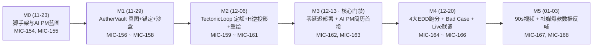

# 三位一体总蓝图：开发 × Demo × 简历宣传一体化执行方案

> **Linear Project ID**：`P-MIC-5` ([Spatial AI 双引擎作品集 · AetherVault & TectonicLoop](https://linear.app/merle/project/spatial-ai-双引擎作品集-aethervault-and-tectonicloop-2cd268daef88))  
> **求职优先级**：**AI 产品经理（AI PM）优先** · **AIGC / 空间智能应用研发兼投**

---

## 一、 为什么必须用「双模同构架构」破局？

传统作品集存在两难死结：
- **纯静态 HTML 概念页**（如初版 `ai.html`）：无真实美图流、无真实 Before/After 重绘图片、Eval 指标停留在纸面 Target，二面技术深挖容易被看穿；
- **纯在线重型生图后端**：推理慢（15~30s）、烧 GPU 费用高、公网链接极易因超时或额度问题在 HR 点开时崩溃。

**破局解法：一套契约驱动的 Dual-Mode 双模工程**：
1. **`⚡ Instant Showcase Mode`（公网秒开版 · M3 首轮投递武器）**：
   - 前端读取经真实离线管线打标、重绘和预烘焙好的 JSON 与高清图像包；
   - HR/总监在手机或办公室电脑打开链接，**0 秒冷启动等待**、**`<20ms` 光谱重排**、**60fps 拖拽 Before/After 实景重绘窗帘**。
2. **`🧪 Live Engine & Eval Mode`（本地演示 & 二面加试护城河 · M4 闭环）**：
   - 本地 FastAPI (`127.0.0.1:8780`) 实时运行五点锚定解析、Prompt AST 编译器、OpenCV/DLT 单应性逆投影（$H/H^{-1}$）和 Zero-LLM `Decimal` 规则引擎；
   - 配齐 `eval_01` ~ `eval_04` 自动化基准脚本，实证每项简历数字并展示 Bad Case 归因。

---

## 二、 个人既有资产精准复用图谱

| 既有项目 | 复用模块 / 设计基因 | 在本作品集中的落点 |
| :--- | :--- | :--- |
| **`P-MIC-4` Aesthetic KB** | 跨领域参考图采集流程、OKLab 主色板提取、反例过滤思路 | 赋能 **AetherVault (`M1-1`, `M1-2`)** 快速策展 80 张跨 5 门类高清样本 |
| **`02-aurora` 材研** | 253 项回归验证的 `Decimal` 精确计价、损耗取整、未知项不置 `0` 准则 | 赋能 **TectonicLoop (`M2-1`)** 构造定额表与 Zero-LLM 算账内核 |
| **`03-super-agent`** | 施工图 Diff Slider 对比交互组件、工作流阶段状态清晰呈现 | 赋能 **TectonicLoop (`M2-3`)** 实景重绘 Before/After 窗帘滑块 |

---

## 三、 6 周里程碑与 Linear Issues 全景映射表

| Milestone | 周期目标日期 | Linear Issue | 角色视角 | 核心交付物与验收抓手 |
| :--- | :--- | :--- | :--- | :--- |
| **M0** | 2026-11-23 | `MIC-154` | AI PM | `04-spatial-ai-portfolio/` 全套战略、剧本、简历库与 Linear 建档 |
| **M0** | 2026-11-23 | `MIC-155` | Tech | `D:\Projects\spatial-ai-portfolio` 双模脚手架与 `bridge.ps1 smoke-math` 全绿 |
| **M1** | 2026-11-29 | `MIC-156` | AI PM | 80 张跨 5 门类样本库 + 8 轴 × 5 点黄金锚点标尺与物理判据 |
| **M1** | 2026-11-29 | `MIC-157` | Tech | `anchor_scorer.py` 批量 JSON + 6 组多图直喂 vs AST 编译生图对照图 |
| **M1** | 2026-11-29 | `MIC-158` | PM+UX | Project A 真图瀑布流 + 2 轮视觉二分校准卡 + 生图对比抽屉 (`<20ms`) |
| **M2** | 2026-12-06 | `MIC-159` | AI PM | 30 项外立面构造包、排雷规则表、3 套案例状态树与 CAD 白线节点图 |
| **M2** | 2026-12-06 | `MIC-160` | Tech | `relight_inpaint.py` + 3 套照片级案例高/中/低档树影锁定重绘实图 |
| **M2** | 2026-12-06 | `MIC-161` | PM+UX | Project B 实景底图 + Before/After 窗帘滑块 + 动态灭点分缝 + VE 任务书导出 |
| **M3** ★ | 2026-12-13 | `MIC-162` | Showcase | 公网秒开部署（Vercel/GitHub Pages），双模顶栏 + 埋点 + 响应式适配 |
| **M3** ★ | 2026-12-13 | `MIC-163` | GTM | 定稿 AI PM 主力版 + 研发版双简历，彩排 3 分钟剧本，**启动首轮投递** |
| **M4** | 2026-12-20 | `MIC-164` | EDD | 运行 `eval_01`~`eval_04`，生成真实评测 JSON 与 Markdown 基准报告 |
| **M4** | 2026-12-20 | `MIC-165` | AI PM | Tab 03 升级真实散点图、3 类 Bad Case 归因及 `¥0.008/图` 成本账本 |
| **M4** | 2026-12-20 | `MIC-166` | Tech | 本地 FastAPI Live 联调（任意模糊词解析 + 4 点拉框投影），二面加试防御 |
| **M5** | 2027-01-03 | `MIC-167` | GTM | 录制剪辑 90s 高清带字幕 Showreel + 首屏对比 GIF，嵌入简历二维码 |
| **M5** | 2027-01-03 | `MIC-168` | GTM | 小红书反差爆款贴 + 知乎方法论长文 + GitHub 开源门面，真实数据回填简历 |

---

## 四、 AI PM 与 AI Builder 简历组合投递策略

- **投递「AI 产品经理 / 多模态与创意工具 PM」**：
  - 简历占篇 60% 聚焦 **《Spatial AI 端到端设计生产力双引擎（TectonicLoop & AetherVault）》**；
  - 第二项目搭配 **`03-super-agent`**（展示复杂多 Agent 三层 Router 分工与人机确认状态机）；将 `02-aurora` 的精确计价经验并入 `TectonicLoop` 叙事，确保简历每一寸版面都在讲不同维度的 AI PM 硬核能力。
- **投递「AIGC / 空间智能应用全栈研发」**：
  - 主推 **TectonicLoop**（强化 `OpenCV` 单应性投影、本征树影锁定与 `Decimal` 确定性引擎）+ **`03-super-agent`**（Router + Rhino/GH）+ **`01-agent-visualizer`**（游戏化交互与 Canvas/Three.js）。
