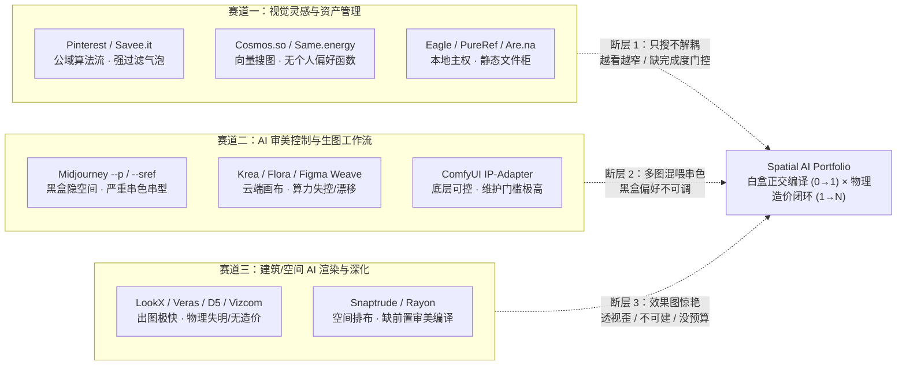

# Spatial AI Portfolio 竞品研究与整体产品设计理念

> **归档日期**：2026-11-28  
> **适用范围**：`Spatial AI Portfolio`（`AetherVault` + `Personal Aesthetic Atlas / Taste Engine v2.1` + `TectonicLoop`）整体产品定位、竞品差异化、设计哲学与核心取舍。  
> **证据口径**：内部指标全部来自本仓库实测报告（`measured` / `observed`），尚未完成实证的阶段统一标注 `UNPROVEN`。

---

## 1. 竞品全景研究：三大割裂赛道与中间的「真空带」

Spatial AI Portfolio 并非在单一软件品类中做同质化内卷，而是切入当前创意与空间设计工具链中**三个彼此断裂的赛道交界处**：

### 1.1 赛道一：视觉审美图谱与灵感库（Discovery & Curation）

| 竞品 | 核心定位与优势（`observed`） | 结构性局限 |
| :--- | :--- | :--- |
| **Pinterest** | 全球最大的视觉 Taste Graph，广度极强，支持局部裁切搜图与风格背景生成。 | 商业化互动闭环天然制造**过滤气泡**与同质化 AI Slop；算法只知道你收藏了“粉色建筑”，无法区分你爱的是色彩关系、材质肌理还是挑檐结构。 |
| **Cosmos.so** | 设计师审美策展平台；基于 Qdrant 向量搜图/精确色值检索、AI 自动打标、支持一键屏蔽 AI 生成图。 | 本质仍是**社交策展流**，缺乏显性的个人偏好数学模型（Taste Model），既不能跨门类正交拆解，也不通向下游受控生图与工程落地。 |
| **Are.na** | 反算法、无广告的“数字花园”（Block/Channel），适合慢速学术与跨学科联想。 | **刻意零 AI 检索**，全靠人工命名建通道，大量未整理素材沦为 `IMG_9823.jpg` 信息孤岛，无法做视觉语义重排或像素级反差探索。 |
| **Same.energy** | 纯粹的视觉计算机视觉搜索引擎，点图即按构图/光影/氛围重排无限网格。 | 只是**单点探索引擎**，没有私人资产沉淀、分层品味校准或下游工作流编排。 |
| **Eagle.cool / PureRef / Refn.app / MyMind** | `Eagle`/`Refn` 强在本地文件主权与 AI 语义搜索；`PureRef` 是建模旁置顶贴图板；`MyMind` 零整理私密入库。 | 停留在**被动存储/贴图板**层面：无法表达“借图 A 的镜头 + 图 B 的材质 + 图 C 的光影”，也缺少防止自我信息茧房的主动破圈机制。 |

### 1.2 赛道二：AI 个性化审美与生图风格控制（Generative Style Control）

| 竞品 | 核心机制与优势（`observed`） | 结构性局限 |
| :--- | :--- | :--- |
| **Midjourney (`--p` / Moodboards / `--sref`)** | **最直接的正面竞品**。通过 Pairwise A/B 投票训练个人 `--p` 偏好档，并用 Moodboards / `--sref` 迁移风格。 | ① **Style Bleed（串色串型）与解耦失效**：拉高 `--sw` 会让参考图的色彩、主体和构图强行覆盖提示词；② **黑盒模式坍塌（Mode Collapse）**：不靠人为狠点 Skip 极易污染隐空间，且用户完全看不见权重、无法手动拨动单一美学轴；③ 投票不分门类与宏观/微观层次。 |
| **Flora / Figma Weave (Weavy.ai) / Krea.ai** | 云端多模型节点画布。`Weave` 支持 Image Describer 拆解参考图并封装 App Mode；`Krea` 强在实时画布、22K 放大与自定义 LoRA。 | ① **云端重 API 积分燃烧，单图成本不可控**；② 多镜头/空间主体易漂移；③ 止步于“生成好看的平面图”，不对透视几何、构造节点与落地预算负责。 |
| **ComfyUI (IP-Adapter + ControlNet)** | 开源生态可控度天花板，可深入 Tensor、注意力权重与多 ControlNet 编排。 | **极高的工程与维护门槛**（显存管理、自定义节点更新断链、难协作），不适合设计师日常高频比选与对外汇报。 |

### 1.3 赛道三：建筑/空间 AI 渲染与前期深化（Spatial AI Design-to-Cost）

| 竞品 | 核心机制与优势（`observed`） | 结构性局限 |
| :--- | :--- | :--- |
| **LookX AI / Veras / D5 Render / Vizcom** | `Veras` 直连 Revit/Rhino/SketchUp 实时渲染；`LookX` 专攻建筑风格模型；`D5` / `Vizcom` 分别主攻实时光追与手绘渲染。 | **对物理规律失明（Hallucination vs. Physics）**：扩散模型不懂承重、收口、防水与消防红线，常生成无法施工的假大空效果，且**与造价清单彻底断链**。 |
| **Snaptrude / Rayon.design** | 浏览器端协同平面/体块建模，打通早期体量到轻 BIM 的几何数据。 | 偏重平面排布与体量效率，缺乏前置跨界美学编译，也无法对既有商业立面做像素级视角锁定的多档 VE 替换与确定性损耗算账。 |

---

## 2. 整体设计理念：双引擎·正交受控的建筑学专著仪器

> **核心命题**：把空间创意工作流里最容易失控的两端——**前端的「玄学审美探索（0→1）」**与**后端的「效果图到落地造价断层（1→N）」**——改造成一套**白盒可拆解、确定性托底、诚实暴露边界的精密设计仪器**。

### 四大核心设计哲学

1. **AI 与确定性的克制边界（Disciplined AI vs. Deterministic Boundary）**
   - LLM/VLM 仅承担三类高语义任务：离线入库标定（五点锚定）、模糊意图解析、以及共享锚点完成度评审。
   - 其余全部 **Zero-LLM 确定性计算**：`<20ms` 向量重排与分层 BT、OKLab + 4×4 Sobel/Luma 像素反差计算、`H/H⁻¹` 单应性立面投影、以及 `Decimal` 含损耗工程算账。
2. **正交解耦胜过端到端黑盒（Orthogonal Disentanglement）**
   - 表达层：将参考图强制拆入 **`Optics（镜头构图）` ⊥ `Material（材质肌理）` ⊥ `Lighting（光影色温）`** 三个互斥槽位，自动生成负向隔离护栏。
   - 品味学习层：将主观偏好拆为 **4 层同门类对照（`T1–T4`）**，并将 **Q1（核心口味）** 与 **Q2（破圈收藏意愿）** 物理分表隔离，杜绝互相污染。
3. **多元自我与高门槛破圈（Multi-Medoid Identity & High-Craft Serendipity）**
   - 用 **`K=10` Ward Medoids** 保留多元审美子人格而非单质心坍塌。
   - 探索通道（`≤15%`）绕过核心口味预筛，但必须先过**像素级反差（`≥P90`）**与**完成度锚点**双门禁——宁可诚实欠填，绝不灌水。
4. **白纸专著美学与彻底诚实（Architectural Monograph & Radical Honesty）**
   - 遵循 `DESIGN.md` 的 **Architectural Monograph（`#FFFFFF` 画廊白纸 + `#F4F5F7` 浅冷灰 + `1px` 瑞士细线 + 单一 `#153CE8` 信号蓝）**，100% 保护摄影与 OKLab 色板的中性白平衡。
   - 显式公开误差边界（原始 VLM `ρ=0.6107`、算账误差样本、3 类 Bad Case、`UNKNOWN_PRICE_MISSING` 强制阻断）。

---

## 3. 核心解决的问题、实测证据与取舍

### 3.1 四大问题闭环

| # | 真实痛点 | 系统解法 | 实测证据与诚实状态 |
| :--- | :--- | :--- | :--- |
| **P1** | 说不清“要的感觉”，搜图陷在同品类抄袭 | 8 轴连续美学光谱 + 显著性门控 `s_i` + 2 轮视觉二分校准 | `measured`：80 资产 `p95=0.152 ms`，跨界 Top-5 对齐 `100%`（多样性 `75%` vs CLIP `31%`），校后 `ρ=0.8577`。 |
| **P2** | 推荐越用越窄，破圈又全是低质图或“变暗伪反差” | Taste Engine v2.1：`K=10` Medoids + 4 层同门类 BT + OKLab/4×4 像素反差 + 共享锚点完成度评审 | `measured`：1,500 图池 3 通道重排 `p95=19.8 ms`（`<20ms`）；`UNPROVEN`：分层票 `9/60`、反差锚点 `0/8`，Stage 3–5 盲测与全漏斗成本待跑通。 |
| **P3** | 多参考图直接喂 AI 生图必定串色串构图 | 3 槽位正交 Prompt AST 编译器 + 互斥负向护栏 | `measured`：20 组混搭词法解耦 `100%`（隔离 `40` 冲突，`0` 泄漏 vs 直喂 `45%`），6 组实测前后帘幕对照。 |
| **P4** | AI 效果图透视歪、不可建、预算黑盒 | TectonicLoop：`H/H⁻¹` 立面锁缝 + 本征光照融合 + 8 条构造排雷 + 30 SKU `Decimal` 含损耗算账 | `measured`：灭点偏差 `0.0°`（`<1.5°`）、非掩码 PSNR `99.0 dB`（`≥38 dB`）；15 笔决算回测 `86.7% (13/15)` 在 ±15% 内（`0.03 ms`）；缺价 100% 阻断。 |

### 3.2 五项明确取舍（Deliberate Non-Goals）

1. **离线锚点标定 + 本地确定性引擎** vs 本地微调 CLIP/LoRA（换来 `≤¥0.008/图`、`<20ms`、白盒可调与零 GPU 公网部署；极端微笔触由 256d 多模态嵌入与 `K=10` Medoids 兜底）。
2. **90–300㎡ 商业立面微改造 + 人工标尺锚定** vs 全量 3D BIM/结构抗震（用 20% 复杂度吃掉 80% 改造前期痛点；斜角 `≥32°` 主动降级四点手动校准）。
3. **探索通道宁可诚实欠填（当前 `127/166`）**，绝不降质凑满 15%。
4. **Q1 核心口味 ⊥ Q2 破圈收藏物理分表隔离**，绝不用历史暂缓图当负样本。
5. **公私双模同构隔离**：公开 80 图零登录极速体验（未来融通脱敏 3D 星图与交互式反茧房演示），私有 1,500 图与校准日志永不入库 Git。

---

## 4. 与核心竞品的本质区别

| 评估维度 | Pinterest / Cosmos | Eagle / PureRef / Are.na | Midjourney (`--p`/`--sref`) / Krea / Flora | LookX / Veras / D5 | **Spatial AI Portfolio** |
| :--- | :---: | :---: | :---: | :---: | :---: |
| **个人审美建模** | 黑盒流（易陷茧房） | 无（人工分类） | 黑盒隐空间（易模式坍塌） | 无 | **白盒 K=10 Medoids + 4 层 BT + 8 轴可调** |
| **主动破圈且保底质量** | 弱（易混 AI Slop） | 无 | 弱（越投越单一） | 无 | **OKLab/4×4 像素反差 `≥P90` + 完成度锚点** |
| **多参考图正交解耦** | 不支持 | 不支持 | 易串色串型（Style Bleed） | 整体迁移 | **3 槽位 AST (`Optics ⊥ Material ⊥ Lighting`)** |
| **交互重排延迟** | 云端百毫秒~秒级 | 本地快（偏整图） | 云端重生成（秒~数十秒） | 渲染秒~分钟级 | **Zero-LLM `<20ms`（实测 `0.15ms` / `19.8ms`）** |
| **成本透明与压控** | 广告 / 订阅 | 买断 / 订阅 | 积分黑盒燃烧 | 高算力订阅 | **全漏斗单图账本压控 `≤ ¥0.008/图`** |
| **物理建构与造价闭环** | 无 | 无 | 无 | 物理失明 / 无造价 | **`H/H⁻¹` 透视锁 + 8 条排雷 + `Decimal` 缺价阻断** |
