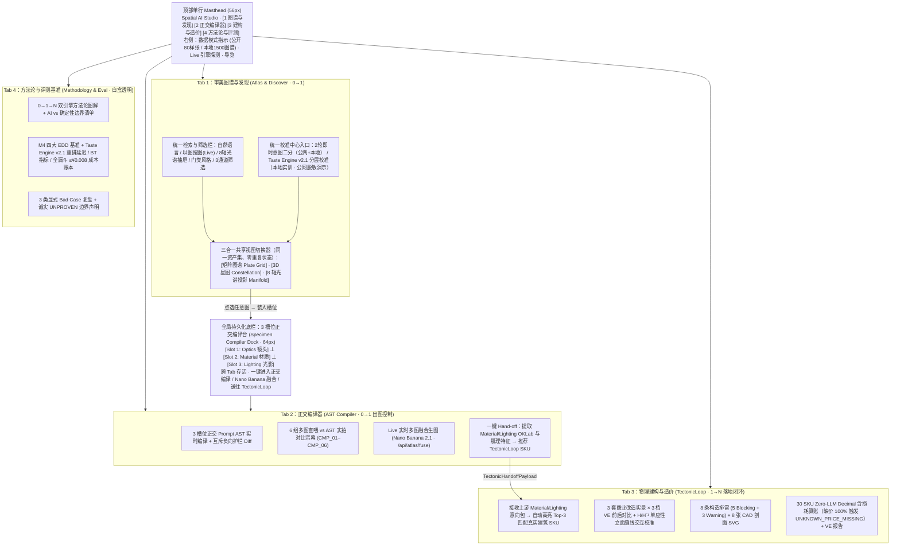
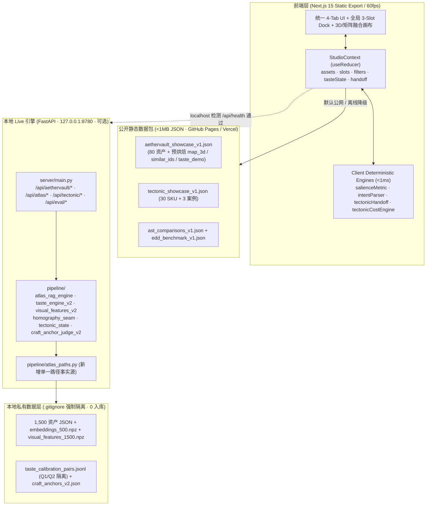

# Spatial AI Studio — 融合版全功能规格与技术架构蓝图 (`SPEC`)

> **版本**：`v3.0-unified-spec` · **日期**：2026-11-28  
> **目标**：将当前割裂的 **Studio（80 公开样张 · 8 轴光谱 · 3 槽位 AST · TectonicLoop）** 与 **Personal Atlas（1,500 私人图谱 · 3D 星图 · 多模态 RAG · Taste Engine v2.1）** 彻底融合为**单一连续工作流产品（`Spatial AI Studio`）**，在保证「公网 0 秒冷启动 + 私有数据 0 泄露」的前提下，打通 **`0→1 审美图谱发现与反茧房` → `正交 3 槽位 AST 编译` → `1→N 物理建构排雷与造价闭环`** 全链路。  
> **关联文档**：[PRODUCT_DESIGN_THESIS.md](file:///D:/Projects/spatial-ai-portfolio/docs/PRODUCT_DESIGN_THESIS.md) · [taste_engine_v2.md](file:///D:/Projects/spatial-ai-portfolio/docs/specs/taste_engine_v2.md) · [DESIGN.md](file:///D:/Projects/spatial-ai-portfolio/DESIGN.md)

---

## 1. 产品整合核心目标与信息架构（消灭「两张皮」）

### 1.1 现状 6 大结构断层（基于代码实测）
1. **双外壳割裂**：`web/src/App.tsx` 通过 `surfaceMode: 'atlas' | 'studio'` 互斥切换，本地进 Atlas 后隐藏 Studio 导航、Live 探测与导览。
2. **状态孤岛**：`PersonalAestheticAtlas` 内部的 `liveAssets`、`fusionIds` 与 `AetherVaultWorkspace` 的 `selectedSlots (optics/material/lighting)` 彼此不可见。
3. **平行 3D 与检索引擎**：Atlas 用 `AestheticConstellation3D` + 8 `archetype`/28 风格/多模态 RAG；Studio 用 `AetherVaultManifold3D` + 5 域/8 轴显著性距离。
4. **双校准脱节**：`TasteCalibrationModal`（4 层 BT + 3 通道）落盘后不刷新主界面状态；`VisualCalibrationPanel`（2 轮二分）仅作用于 Studio 内存态。
5. **上下游断链**：0→1 阶段选出的材质/光影槽位与融合结果，无法传递到 `TectonicLoop` 驱动真实立面 SKU 推荐与造价对比。
6. **公私数据与后端双源风险**：公网版缺少 3D 星图和反茧房可视化；后端 `atlas_rag_engine.py` 与 `taste_engine_v2.py` 读写两份不同路径的 1,500 图 JSON。

### 1.2 融合后统一信息架构（单一外壳 · 4 大主工作台 + 1 条全局持久化底栏）



---

## 2. 完整功能清单（Feature Matrix：公网 Showcase vs 本地 Live）

| 域 | 功能编号与名称 | 核心能力说明 | 公网静态版 (`80` 公开样张) | 本地双模版 (`1,500` 图谱 + FastAPI) | 来源策略 |
| :--- | :--- | :--- | :---: | :---: | :--- |
| **F1 统一外壳与数据切换** | `F1.1` 单一 Masthead 与 4 Tab 路由 | 废弃 `surfaceMode` 隔离；所有 Tab 共享顶部栏、Live 探测与 Guided Tour | 完整支持 | 完整支持 | 重构 `App.tsx` |
| | `F1.2` 公私数据集无缝切换 | 公网仅加载 `<500KB` 脱敏 `80` 样张包；本地自动加载 `1,500` 私人图谱，并支持一键切回 `80` 公开包验证公网效果 | 固定 `public_80` | `private_1500` / `public_80` 切换 | 新建 `StudioContext` |
| **F2 图谱发现与多视图** | `F2.1` 统一检索与过滤栏 | 融合文本关键词（`intentParser`）、8 轴连续光谱抽屉、门类/风格胶囊、OKLab 色板筛选与 3 通道筛选（全部/核心共鸣/跨界桥接/像素反差探索） | 全部客户端 `<1ms` 运行 | 客户端 + `/api/atlas/semantic-search` 图文多模态 RAG | 合并改造 |
| | `F2.2` 三合一视图切换（矩阵 / 3D 星图 / 8 轴投影） | 同一筛选与排序结果实时同步至：`Plate Grid`、`AestheticConstellation3D`（支持重力/地形/OKLab 3 布局）、`AetherVaultManifold3D` | **全部支持**（为 80 样张预烘焙 `map_3d` 与 `similar_ids`） | 全部支持（1,500 节点 60fps） | 复用 + 预烘焙脚本 |
| | `F2.3` 3D 画布「白纸专著 / 暗室观测」双背景切换 | 默认跟随 `DESIGN.md` 白纸底（`#FAFBFD` + 墨黑/信号蓝细线），一键切暗室观测模式（`#0E1015`），彻底消除明暗视觉断层 | 完整支持 | 完整支持 | 改造 `AestheticConstellation3D.tsx` |
| | `F2.4` 统一详情灯箱（Specimen & Critique Lightbox） | 展示无水印 4:3 原图、OKLab 5 色条、8 轴雷达、审美评论/原理、Top-N 相似邻居跳转，以及一键装填 3 槽位 | 完整支持 | 完整支持（含 6 大审美家族标签） | 合并 `SpecimenLightbox` & `AestheticDetailModal` |
| | `F2.5` 拖拽新图入库（Drop-In Ingest） | 拖拽最多 12 张本地图片，64-bit dHash 去重 + Embedding + 自动定位进 3D 星图并即时写入全局状态 | 隐藏/只读提示 | 完整支持（`/api/atlas/ingest`） | 接入 `StudioContext` |
| **F3 统一品味校准中心** | `F3.1` 即时意图二分校准（Session 2-Click） | 输入模糊语义后，弹出 2 轮视觉二分卡，2 次点击实时收敛 8 轴查询向量与显著性权重 | 完整支持（纯前端） | 完整支持 | 复用 `VisualCalibrationPanel` |
| | `F3.2` 长期品味校准（Taste Engine v2.1） | `K=10` Medoids 展示、4 层同门类 Q1 投票（`T1–T4`）、Q2 像素反差独立表、8 域「完成度标准」双问确认；提交后**立即刷新画廊 3 通道标签与排序** | 脱敏只读交互原理演示（零私人数据泄露） | 完整实训与落盘（`/api/atlas/calibration/*`） | 升级 `TasteCalibrationModal` |
| **F4 正交编译器与融合** | `F4.1` 全局持久化 3 槽位底栏 Dock | 跨 Tab 保持 `Optics` / `Material` / `Lighting` 槽位；支持拖拽/点击清空、交换与状态提示 | 完整支持 | 完整支持 | 提升至 `App` 级组件 |
| | `F4.2` 冲突隔离 Prompt AST 编译器 | 确定性剥离非本槽属性 + 注入互斥负向护栏 + 中英对照输出；Live 态校验后端 `/api/aethervault/compile-ast` | 纯前端 `<1ms` 编译 | 前端 + FastAPI 双核校核 | 复用 `salienceMetric.ts` |
| | `F4.3` 6 组实拍前后对比帘幕 | `CMP_01–CMP_06` 指针拖拽 + 键盘步进对比「多图直喂串色 vs AST 正交编译」 | 完整支持 | 完整支持 | 复用 `BeforeAfterSlider` |
| | `F4.4` Live 实时多图融合（Nano Banana 2.1） | 直接把 3 槽位选中的资产作为参考图发起 `/api/atlas/fuse`，产出实时融合预览图 | 显示预设样例对照 | 完整支持（实时调 API） | 改造 `AtlasStudioModals` |
| | `F4.5` 一键 Hand-off 至 TectonicLoop | 根据 `Material` + `Lighting` 槽位的 OKLab 色值与材质描述符，确定性匹配立面 SKU Top-3，跳转 Tab 3 并高亮提案 | 完整支持（纯确定性） | 完整支持 | **新增核心闭环引擎** |
| **F5 物理建构与造价** | `F5.1` 上游意向承接条（Handoff Banner） | 展示来自 Tab 1/2 的参考图材质卡、匹配到的 3 个真实建筑 SKU，一键应用到当前立面改造区域 | 完整支持 | 完整支持 | **新增组件** |
| | `F5.2` 3 套商业立面 × 3 档 VE 实景对比 | 9 张本征光照融合重绘对比（高/中/经济三档），附灭点偏差与非掩码 PSNR 读数 | 完整支持 | 完整支持 | 复用 `TectonicLoopPreview` |
| | `F5.3` `H/H⁻¹` 单应性立面缝线交互校准 | 拖拽四角标尺锚点实时重算单应性矩阵与 3D 立面网格投影（含 `≥32°` 斜角降级告警） | 前端静态演示 | 完整实时计算（`/api/tectonic/project-seams`） | 复用 `LiveHomographyCalibrator` & `TectonicPlane3D` |
| | `F5.4` 8 条构造排雷 + CAD 剖面 + `Decimal` 算账 | 30 个 SKU 自由替换，实时触发 5 Blocking / 3 Warning 规则、查看 8 张 SVG 构造大样、运行 Zero-LLM 含损耗算账（缺价强制报 `UNKNOWN_PRICE_MISSING`）并导出 VE 报告 | 纯前端 `tectonicCostEngine.ts`（分值整数同构） | 前端 + FastAPI `Decimal` 双校验 | 复用 + 增强联调 |
| **F6 方法论与量化评测** | `F6.1` 整合版「方法论 × 评测基准」白盒页 | 合并原 `ThesisOverview` 与 `TechEvalOverview`：双引擎原理图、M4 四大 EDD 基准、Taste Engine v2.1 重排 p95 & 样本状态、`≤¥0.008/图` 成本账本、3 类 Bad Case 公开复盘 | 完整支持 | 完整支持（实时拉取 `/api/eval/benchmark` + 校准统计） | 合并精炼 |

---

## 3. 完整技术框架（Full-Stack Architecture）

### 3.1 技术栈选型（100% 对齐现有 `web/package.json` 与 `pyproject.toml`，零重型新依赖）

| 层级 | 技术选型 | 精确用途与约束 |
| :--- | :--- | :--- |
| **前端框架** | `Next.js 15.3.3` + `React 19.0.0` + `TypeScript 5.8.3` | 生产静态导出（`output: 'export'` → `web/out`，适配 GitHub Pages `/spatial-ai-portfolio` 与 Vercel）；本地开发代理 `/api/*` → `127.0.0.1:8780`。 |
| **UI 与动效** | `Tailwind CSS 3.4.17` + `Radix UI` (6 primitives) + `Framer Motion 12` + `Lucide` | 严格执行 `DESIGN.md`：`#FFFFFF` / `#F4F5F7` / `#0E1015` / `#153CE8`、`Archivo / Manrope / Chivo Mono`、0px 直角、文字 `≥12px`、照片零角标。 |
| **3D 与可视化** | `Three.js 0.176.0` + `Recharts 2.15.3` + 原生 SVG | 3D 星图与 8 轴流形均基于原生 `Three.js` 实例化/纹理按需加载（保持 60fps、避免引入笨重 R3F 依赖）；雷达图与评测图表用 `Recharts` + CAD 剖面 SVG。 |
| **状态管理** | **原生 React Context + `useReducer`**（`web/src/state/StudioContext.tsx`） | 零外部状态库膨胀；跨 Tab 统一持有资产集、3 槽位、筛选、校准态与 Tectonic Handoff；支持 `sessionStorage` 轻量持久化。 |
| **客户端确定性引擎** | `web/src/engine/` (`salienceMetric.ts`, `intentParser.ts`, `tectonicCostEngine.ts`, **新增 `tectonicHandoff.ts`**) | 零 LLM、零网络依赖：`<1ms` 显著性距离重排、AST 冲突编译、OKLab/材质 → SKU 推荐映射、整数分同构含损耗算账与 8 条排雷。 |
| **本地后端引擎** | `Python 3.12+` + `FastAPI 0.115+` + `Uvicorn` + `Pydantic v2` (`127.0.0.1:8780`) | 提供多模态向量检索、Nano Banana 融合、Drop-In 入库、Taste Engine v2.1 分层 BT 与 3 通道重排、`H/H⁻¹` 透视计算与 `Decimal` 精算。 |
| **数值与 CV 管线** | `NumPy` + `SciPy` + `OpenCV Headless` + `Pillow` + `Decimal` | OKLab 色彩直方图、4×4 Sobel 边缘与亮度分布、Ward 层次聚类 Medoids、7 参分层 Bradley-Terry、单应性矩阵与本征光照融合。 |
| **外部 AI 边界（仅离线/按需）** | `Gemini Embedding 2` (256d) / `Gemini 4 Hydrogen` (Anchor Judge) / `Nano Banana 2.1` (Fusion) | 一律读取本机环境变量，源码与 JSON 零密钥；全漏斗成本按账本压控 `≤ ¥0.008/入库图`。 |

### 3.2 分层系统架构图



---

## 4. 核心数据与状态契约（Types Before Logic）

### 4.1 统一资产类型 `UnifiedAsset`（消除 `showcase_v1` 与 `personal_500` 双套分支）

```ts
export type AssetOrigin = 'curated_80' | 'pinterest_personal' | 'profile_expansion' | 'dropin_live';
export type TasteLane = 'core_resonance' | 'cross_domain_bridge' | 'adversarial_exploration' | 'unassigned';

export interface UnifiedAsset extends AetherVaultAsset {
  // 统一必选字段（公开 80 图由离线脚本确定性补全，私有 1500 图直接复用）
  source_origin: AssetOrigin;
  archetype: string;              // 统一门类 key（architecture/interior/landscape/industrial/graphic_typography/...）
  archetype_label: string;        // 中文门类显示名
  aesthetic_style_zh: string;     // 风格归类
  map_3d: [number, number, number]; // 3D 星图确定性坐标（公开 80 图基于 8 轴 + OKLab PCA 预烘焙）
  similar_ids: string[];          // Top-8 近邻资产 ID
  // Taste Engine v2.1 运行时附加字段（可选）
  taste_lane?: TasteLane;
  contrast_axis?: 'color_oklab' | 'composition_4x4' | 'semantic_residual' | null;
  contrast_reason_zh?: string;
}
```

### 4.2 全局统一状态 `StudioState`（`web/src/state/StudioContext.tsx`）

```ts
export type UnifiedTabId = 'discover' | 'compiler' | 'tectonic' | 'methodology';
export type DiscoverViewMode = 'grid' | 'constellation3d' | 'manifold3d';
export type CanvasThemeMode = 'paper' | 'obsidian'; // 3D 画布默认白纸专著，可一键切暗室观测

export interface AstSlots {
  optics: UnifiedAsset | null;
  material: UnifiedAsset | null;
  lighting: UnifiedAsset | null;
}

export interface TectonicHandoffPayload {
  created_at: string;
  source_material_asset: Pick<UnifiedAsset, 'asset_id' | 'title' | 'image_url' | 'akb_palette_hex'> | null;
  source_lighting_asset: Pick<UnifiedAsset, 'asset_id' | 'title' | 'image_url' | 'akb_palette_hex'> | null;
  compiled_material_clause: string;
  compiled_lighting_clause: string;
  target_palette_hex: string[];
  recommended_sku_ids: Array<{ sku_id: string; match_score: number; reason_zh: string }>;
}
```

### 4.3 后端单一事实源与 API 契约（零破坏性变更）
- **新增模块**：`pipeline/atlas_paths.py`，集中定义并校验 `ATLAS_ASSETS_JSON`、`EMBEDDINGS_NPZ`、`VISUAL_FEATURES_NPZ`、`CALIBRATION_LOG_JSONL`、`CRAFT_ANCHORS_JSON`，同时由 `atlas_rag_engine.py` 和 `taste_engine_v2.py` 导入，彻底杜绝双路径漂移。
- **保留全部现有路由**（`/api/health`, `/api/aethervault/*`, `/api/tectonic/*`, `/api/eval/benchmark`, `/api/atlas/*`），仅在 `/api/atlas/ingest` 返回完整 `UnifiedAsset` 结构以便前端 `StudioContext` 零转换写入，并在 `/api/atlas/calibration/rerank` 返回轻量 `{ asset_id -> taste_lane }` 映射表驱动画廊实时打标与筛选。
- **离线预烘焙脚本**：新增 `pipeline/enrich_public_80_constellation.py`，仅读取公开 80 样张的 `style_spectrums` + `akb_palette_hex` 生成确定性 `map_3d`、`similar_ids`、`archetype` 字段及一份零隐私脱敏的 `taste_demo_snapshot`（写入 `web/public/data/aethervault_showcase_v1.json`，包体增量 `< 60 KB`）。

---

## 5. 明确 Non-Goals（防范围膨胀护栏）

1. **不做用户登录、多租户云数据库或后台管理系统**：保持公开零摩擦访问 + 本地私人数据主权。
2. **不把 1,500 张私人图谱或 8.3 MB JSON 打包进公网静态构建**：`next build` 导出校验强拦截私有大文件，公网仅部署脱敏 80 样张。
3. **不在本次前端整合阶段跑外部付费 VLM/生图批量调用**：整合工程全部基于确定性算法与已有预烘焙资产；Taste Engine v2.1 Stage 3–5（外源补库 + VLM 完成度评审 + 20 题盲测）作为独立 Phase 5 在用户完成 60 题校准后按账本执行。
4. **不引入额外重型前端库**（不加 Redux/Zustand、不加 React Three Fiber、不换掉 Tailwind v3）：完全基于现有 `package.json` 依赖实现。
5. **不碰简历站点或更改既有品牌视觉底色**：严格遵守 `DESIGN.md` 白纸信号蓝体系，不回退到暗黑 SaaS 面板。

---

## 6. Pre-Mortem（事前验尸：最可能失败的 3 个坑与硬性防线）

| 风险等级 | 潜在失败场景（2 周后可能引发回滚的原因） | 硬性工程防线（写入代码与验收门禁） |
| :---: | :--- | :--- |
| **R1** | **公网静态导出意外夹带 8.3 MB 私有图谱 JSON 或私有 WebP**，导致隐私泄露或 GitHub Pages 首屏卡死 | 在 `web/scripts/verify_export.mjs`（构建后钩子）硬断言：`web/out/data/` **不存在** `aethervault_personal_500.json` 与 `aethervault_rag_500.jsonl`，且 `web/out/assets/` 不存在 `pinterest_500/`；单页首屏数据 `< 1 MB`。 |
| **R2** | **3D 星图与主站白纸视觉割裂或移动端 WebGL 崩卡**（390px 手机端同时加载 3D 纹理导致 OOM/白屏） | ① `AestheticConstellation3D` 原生支持 `canvasTheme: 'paper' | 'obsidian'`，默认白纸底；② 视图切换采用按需挂载，移动端（`< 768px`）默认进 `Plate Grid`，切 3D 时自动降采样纹理并释放旧 WebGL `dispose()`。 |
| **R3** | **组件巨石耦合难以维护**（现有 `AetherVaultWorkspace.tsx` 1,805L + `PersonalAestheticAtlas.tsx` 1,210L 直接硬拼会变成 3,000L 灾难） | 拆分为单一职责模块：`StudioContext.tsx`（状态）+ `DiscoverWorkspace.tsx`（统一发现编排）+ `CompilerWorkspace.tsx`（3 槽位 AST/对比/融合）+ `GlobalCompilerDock.tsx`（底栏）+ `tectonicHandoff.ts`（确定性 SKU 映射）；单文件严格控在合理粒度。 |

---

## 7. 分阶段开发计划与可证伪验收门禁（Done Predicates）

| 阶段 | 核心交付内容 | 完成后可运行的硬性验收命令 / 现象（`Prove It Works`） |
| :--- | :--- | :--- |
| **Phase 1：数据底座与状态统一** | ① `pipeline/atlas_paths.py` 统一后端路径；② `pipeline/enrich_public_80_constellation.py` 为公开 80 样张补齐确定性 `map_3d`/`similar_ids`/`taste_demo_snapshot`；③ 新建 `web/src/state/StudioContext.tsx` 与 `web/src/engine/tectonicHandoff.ts` + 单元单测。 | `py -3.12 -m unittest discover -s tests -v` 全绿；`aethervault_showcase_v1.json` 含 80 条有效 `map_3d` 且大小 `< 500 KB`；`npx.cmd tsc --noEmit` 0 报错。 |
| **Phase 2：统一外壳、3D/矩阵融合画布与全局 Dock** | ① 重构 `App.tsx` 彻底移除 `surfaceMode`，落地 4 Tab 单行导航 + `GlobalCompilerDock`；② 整合 `DiscoverWorkspace`（矩阵 / 3D 星图 / 8 轴流形三视图共享同一筛选结果）；③ `AestheticConstellation3D` 增加白纸专著/暗室观测切换。 | 本地 `8780` + `5174` 实机浏览器验收：在 `1,500` 图谱与 `80` 公开包切换下，3 视图切换 0 报错、点选任意图装入底栏槽位在 4 个 Tab 间 100% 持久。 |
| **Phase 3：全链路闭环打通（校准 ↔ 编译 ↔ TectonicLoop）** | ① `CompilerWorkspace` 整合 AST 编译、6 组对比帘幕、Live Nano Banana 融合与「送往 TectonicLoop」按钮；② `TectonicLoopPreview` 接入 `TectonicHandoffPayload` 一键应用推荐 SKU 并触发排雷与 `Decimal` 算账；③ `TasteCalibrationModal` 提交后实时更新画廊 3 通道标签；④ 合并精炼 Tab 4 `方法论与评测基准`。 | 端到端浏览器实测整条闭环：**3D 星图选材质 → 底栏编译 AST → 一键跳转 TectonicLoop 应用推荐 SKU → 实时触发排雷与造价重算**；1440px 与 390px 均 0 横向溢出、0 控制台错误、0 裂图。 |
| **Phase 4：静态导出安全门禁与 Git 收口** | ① 新增 `verify_export` 校验（杜绝私有文件泄露到 `web/out`）；② `npm.cmd run build` 全量静态导出通过；③ 清理 `web/.next` 并提交规范 `git commit`。 | `npm.cmd run build` 0 报错；导出校验脚本 `PASS`（0 私有文件、0 密钥）；所有单测全绿。 |
| **Phase 5（衔接实证）：Taste Engine v2.1 Stage 3–5** | 在融合后的统一工作台中，由你完成 `~60` 题分层校准与 8 域「完成度标准」双问确认，再执行外源高完成度反差补库 → `craft_anchor_judge_v2.py` VLM 锚点评审 → 20 题留出盲测与全漏斗 `≤¥0.008` 账本实证。 | 产出真实 `eval/reports/taste_engine_v2_blind_eval.json` 与全漏斗成本账本，清零所有 `UNPROVEN` 项。 |
